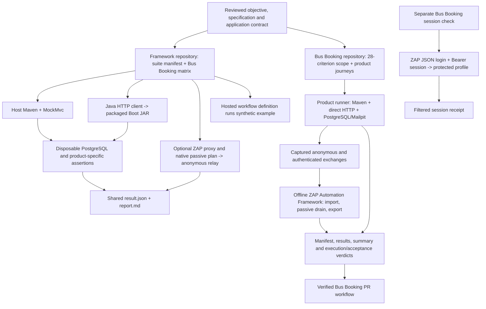

# Current-state technical audit · Security testing framework and Bus Booking

**Audit date:** 24 November 2026, ICT

**Scope:** As-is source, local execution receipts, and GitHub run evidence. The audit ran the shared offline contract tests, validated manifests and existing receipts, compared digests, and read the hosted artifact. The audit started no product application or scanner. The sole deliverable is this report.

## Executive summary

- **The framework pilot and the product PR workflow are separate implementations.** The pilot in `testing-tool-prompt-security` reuses a Python manifest, evidence contract and ZAP Automation Framework wrapper. Its Bus Booking adapters independently verified 102 protected authorization cells over MockMvc and packaged HTTP, plus 18 authentication and role conditions, at Bus Booking commit `56f58a3`. The newer pilot is present as untracked workspace source. The Bus Booking repository has its own committed suite and a verified GitHub Actions run, with no dependency on the shared pilot.
- **The product PR execution gate passed. Security acceptance remains open.** In PR #20, GitHub Actions run `45236299340` recorded 316 passing Maven tests, 100/100 passing HTTP situations on 32/32 operations and 12/12 ownership controls. ZAP passively processed 133 archived exchanges including one self-check. The acceptance verdict was `MISSING`, with 18 of 28 objectives passing, eight under review and two missing browser evidence. The audit independently verified the hosted artifact and its digest. [GitHub Actions run](https://github.com/maaL6/bus-booking-system-phase-2/actions/runs/45236299340)
- **ZAP itself sent an authenticated Bus Booking request in a separate session proof.** The native ZAP Requestor sent Bearer-authenticated `GET /api/auth/me` and the application returned the expected USER identity. This is independent of the ordinary HTTP test clients. The shared pilot still blocks scanner JWT, the product PR workflow imports HAR with sending disabled, and the session proof provides no authenticated passive detector or active scanner outcome.
- **Bus Booking Authenticated Active DAST has no verified execution.** The shared runner explicitly refuses dispatch, the product runner lacks an active implementation, and the prior agent execution boundary prevented active qualification. Existing local evidence establishes Docker connectivity and scanner-owned JWT for one USER and one endpoint. A separate historical synthetic active-rule experiment proves limited engine functionality. Product-specific active execution and its results remain unmeasured.

## 1. Audit boundary and provenance

| Source | Snapshot and evidence boundary |
| --- | --- |
| Framework workspace | `testing-tool-prompt-security` on `main`, tracked HEAD `e8197caab2d530287214b0e7b8231a3691e0bba8` (ByteMe merge PR #2). The new `security_framework`, `feasibility`, suite directories, audit inputs and `security-suite-framework.yml` have no tracked commit in this checkout. Qualify them by retained input hashes and evidence files. Older CSP/ByteMe runners, historical experiments and associated CI are tracked and have separate contracts. |
| Bus Booking security CI worktree | `bus-booking-security-ci`, clean `codex/security-regression-ci` at `56f58a3ed86d22d44bd2007e3a49aeb0c979510f`. The product workflow was added at that commit. Authenticated GitHub metadata reported PR #20 OPEN at audit time. Run head was `56f58a3`; the artifact records tested merge SHA `ff5c9e606697ea87a387f60403ef5408fb5bdcb8`. That merge object is absent from the local checkout. The hosted artifact's suite-file digests match the worktree. [Product commit](https://github.com/maaL6/bus-booking-system-phase-2/commit/56f58a3ed86d22d44bd2007e3a49aeb0c979510f) · [PR #20](https://github.com/maaL6/bus-booking-system-phase-2/pull/20) |
| Bus Booking exploratory worktree | `bus-booking-system-phase-2` at `cc0ac2451227971367de9c7f9153f908c0c8d315`, locally modified. The session-check sources and associated feasibility/roadmap documents are untracked. Historical product-native long-run evidence from this worktree also reports dirty source. These results have narrower provenance than the clean worktree and hosted run. |
| MCP deployment | Historical Guided and Expert audits measured published `mcp-zap-server` v0.16.0 at `0ebe11c3ae4c17de59fde0654e19b3e35e42ca20`, with ZAP 2.17.0. The bundled Java source differs from the published JAR, including a workspace-only experimental JSON Bearer bootstrap provider. The standalone and product runners do not load the MCP server. [Deployment provenance](mcp-zap-deployment-provenance.md) · [Guided versus Expert](mcp-zap-guided-vs-expert.md) |

Product references below use **BB-CI** for the [clean security-CI worktree](/Users/hahoangloc/Working/UET/bus-booking-security-ci) and **BB-LAB** for the [exploratory worktree](/Users/hahoangloc/Working/UET/bus-booking-system-phase-2). Product paths are relative to the named worktree. Several retained execution bundles live under ignored `artifacts/` or `target/`.

## 2. Architecture and relevant directory tree



```text
testing-tool-prompt-security/
  .agents/skills/
    mcp-zap-repo-operations/   Assessment workflow/catalog, bundled MCP runtime and regression generator
    run-semgrep-scanner/      Separate source-assessment tooling
  .github/workflows/
    security-suite-framework.yml     New shared fixture gate
    zap-*.yml                        Older smoke, regression, qualification, experiment and ByteMe CI
  tests/security/
    security_framework/
      manifest.py               Registries, scenario resolution, traceability and source digests
      engine.py                 Native AF admission, phases, job receipts and report ingestion
      evidence.py               Case evidence, validation, aggregate exit and Markdown projection
      run.py                    Host and Docker worker, adapter hooks, identity and block policy
      schemas/  templates/      JSON format references and test specification template
    feasibility/                Original fixture, AF plan, assertions and qualification driver
    suites/
      feasibility_fixture/      Example implementing the shared runner hooks
      bus_booking/
        objectives/ specifications/ cases/ authentication/ suite.json
                                Requirement, test design, case registry, profiles and scenarios
        plans/                  Product method/path and role expectation matrix
        adapter.py  fixtures/   Product source export, Maven/MockMvc, DB and Java fixture
        assertions/             Case/identity oracle and offline qualification controls
        live/                   Packaged runtime, Java HTTP client, passive relay and comparator
        evidence/               Sanitized retained pilot receipts
    zap-image.txt  zap_report.py     Shared scanner image pin and native report parser
    run_zap*_suite.* product/ cases/ qualification/ ci/ experiments/
                                Separate tracked CSP/ByteMe regression and experimental tooling
  artifacts/                    Ignored fuller local qualification output and draft receipts
  docs/ and root evidence files Framework guides, earlier audits and CI contracts

Bus Booking (BB-CI, at 56f58a3)/
  .github/workflows/security-regression.yml    Native pull-request gate
  docs/security-*.md                          Objectives, assessment scope, matrix and runbook
  docs/openapi.json  docs/04-api-design.md      API inventory and expected behavior
  src/main/  src/test/  pom.xml  .mvn/         Product, test classes and build dependencies
  tests/security/
    scope.json                   28 criteria, cases, identities, evidence, exclusions and drift
    run.py                       Fixtures, process phases, Maven/HTTP/ZAP, outputs and teardown
    journeys.py                  Deterministic HTTP, authentication, OTP, roles and state checks
    authorization_matrix.py      Separate exhaustive operation/persona matrix launcher
    traffic.py  zap.yaml         Capture, offline passive import/export and alert reconciliation
    assessment.py               Evidence projection, baseline, criterion and acceptance logic
    test_report.py  baselines/    Reporting/acceptance unit tests and reviewed ARM64 baseline
  target/security/               Ignored local runs and retained hosted artifact

Bus Booking (BB-LAB, exploratory)/
  tests/zap-session-check/        Standalone native ZAP JWT/identity fixture runner and plan
  docs/authenticated-active-dast-feasibility.md
  target/zap-session-check/verified.json
```

The shared engine and manifest use Python's standard library and the tracked `zap_report.py`. The default shared worker imports the selected suite adapter and expects `start_fixture`, `evaluate` and, for scanner work, `build_plan` and identity witnesses where required. The feasibility example implements these hooks and reuses the older synthetic fixture. Bus Booking instead invokes two suite-specific launchers. Both reuse shared manifest/evidence logic through the Bus Booking oracle; live passive also calls the shared engine directly. The product-native workflow has its own Python modules, evidence format and scanner plan. ByteMe's adapter, registry and assessment-to-regression exporter belong to the older tracked lanes. MCP and Semgrep skills are neighboring tools whose availability supplies no evidence of use in either Bus Booking workflow. [Framework architecture](docs/security-test-framework.md) · [Adapter contract](docs/security-test-implementation.md) · [Tracked regression lanes](tests/security/README.md)

## 3. Workflow from objective to CI

| Stage | Shared framework and Bus Booking pilot | Bus Booking's product-native suite |
| --- | --- | --- |
| Define scope and oracle | Stable objective → CWE → Markdown specification → case IDs, auth profile, required evidence keys and expected conditions → named ordered scenario. Bus Booking uses SEC-A01-01/CWE-862 and its reviewed role matrix. The API design supplies policy/status expectations; the static OpenAPI document supplies inventory. | The product's scope documents and `scope.json` map 28 criteria to HTTP, Maven, static/config/runtime or ZAP evidence, required cases and controls. Frontend dependencies are explicit. |
| Validate inputs | `read_suite` checks IDs, metadata links, paths and hashes. Bus Booking exports a committed product revision with `git archive`, compares matrix methods/paths with `docs/openapi.json`, and records design, OpenAPI and POM digests. The syntax/inventory check does not validate every contract response/schema. | `run.py --validate` checks manifest, criteria and operation coverage. During execution the runner reads runtime OpenAPI and records both static and canonical runtime digests. HTTP operation templates and documented contract drift are explicit. |
| Prepare runtime | Shared runner starts the pinned ZAP image with `--network none`, read-only test mount and fresh loopback fixture. MockMvc uses host Java 21, cached wrapper Maven offline and a new PostgreSQL tmpfs container with a random loopback-published port. Live builds in a temporary archive offline, runs the production JAR and a separate compiled Java client in containers sharing PostgreSQL's disconnected loopback namespace, and publishes zero ports. | The runner copies the selected checkout to temporary build space, builds with Maven Wrapper, and starts per-run PostgreSQL, Mailpit and a Java 21 backend JAR on host loopback. DBs for tests and HTTP are separate. Readiness, stage limits, fixture credentials, OTP identity and teardown belong to the product runner. Cold setup may fetch dependencies/images. It records resolved image IDs. |
| Execute behavior | `suites.bus_booking.adapter` runs Surefire/MockMvc through real Spring Security. `suites.bus_booking.live.run` selects `http` or `passive`. The HTTP client calls the product directly; shared Java code sets up fixtures, records response predicates and reads persisted state. Optional ZAP observes a public GET and a synthetic detector control. | `tests/security/run.py` supports quick, full, long and selected cases. Full runs Maven and live HTTP plus offline passive ZAP. Long adds timed token/OTP/rate-limit and seat-race checks. `authorization_matrix.py` is an independent exhaustive matrix command, outside the full PR workflow. |
| Collect evidence | Application receipts feed `oracle.py`. Shared infrastructure binds case inventory, evidence producers/pointers, run ID and declared digests. ZAP receipts add plan and report digests, ordered jobs, expected traffic and detector witnesses. Outputs are `result.json` and `report.md`. Raw traffic/plan/logs and fixture secrets are transient. | Surefire, HTTP response predicates, DB state, runtime/log/config signals, capture reconciliation and alert summaries feed `assessment.py`. Artifacts are `manifest.json`, `results.json` and `summary.md`. The temporary HAR can contain synthetic credentials, tokens and bodies. The uploaded files contain filtered observations. |
| Decide and publish | PASS 0, FAIL 1 (complete contradictory evidence), ERROR 2 (invalid/missing evidence or execution), BLOCKED 3 (no dispatch); precedence ERROR → BLOCKED → FAIL → PASS. The untracked Actions definition gates the feasibility fixture, verifies nonempty outputs and uploads evidence. Pilot product CI uses documented checkout/build instructions only. | The committed workflow runs full mode on PRs to `main`, validates scope, runs reporting tests, posts the summary and uploads all three filtered files. It gates **execution**. `--require-acceptance` is a separate opt-in; it returns 3 when execution passed and acceptance did not. The hosted workflow omits that flag and passes no reviewed baseline. |

Sources: [Pilot cases and scenarios](tests/security/suites/bus_booking/suite.json) · [Evidence contract](ci-verdict-contract.md) · [Shared Actions definition](.github/workflows/security-suite-framework.yml) · [Product runbook](/Users/hahoangloc/Working/UET/bus-booking-security-ci/docs/security-runbook.md) · [Product workflow at tested PR head](https://github.com/maaL6/bus-booking-system-phase-2/blob/56f58a3ed86d22d44bd2007e3a49aeb0c979510f/.github/workflows/security-regression.yml)

## 4. Capability status matrix

**VERIFIED** means retained, executed evidence supports the stated scope. **IMPLEMENTED_NOT_VERIFIED** means source or configuration exists with insufficient execution evidence for that scope. **MISSING** means the applicable implementation, dependency or evidence is absent. **FAILED** identifies an attempted check with an observed unsuccessful outcome. **BLOCKED** identifies an explicit gate or execution constraint. These are audit statuses; suite receipts separately use their own verdict vocabulary. Historical controls and draft outcomes appear with their own scope.

| Capability and scope | Status | Implementation, evidence and limits |
| --- | --- | --- |
| Pilot specification and traceability | VERIFIED | SEC-A01-01/CWE-862 links to nine application groups and separate scanner cases. Input validation, current-source receipts, matrix checks and compare controls were examined. The auxiliary passive case's registry association with this objective supplies transport evidence. [Coverage map](tests/security/suites/bus_booking/specifications/coverage.md) · [Comparison](tests/security/suites/bus_booking/evidence/live/comparison.json) |
| Product-native requirements mapping | VERIFIED | Manifest validation reported 28 criteria, 32 API operations and seven exclusions; hosted results contain all 28 criterion dispositions. Full objective closure remains missing. [Scope manifest](/Users/hahoangloc/Working/UET/bus-booking-security-ci/tests/security/scope.json) · [Hosted bundle summary](/Users/hahoangloc/Working/UET/bus-booking-security-ci/target/security/ci-pr-20/summary.md) |
| Spring MockMvc pilot | VERIFIED | Host Maven invokes the injected Java fixture in a temporary checkout with Spring test profile, fixed clock and real filter chain. PASS 0 for two historical runs and one current-source rerun. 48 route-level denials lacked a selected MVC handler; two ownership denials passed into the booking service. [Fixture](tests/security/suites/bus_booking/fixtures/BusBookingAuthorizationPilotTest.java) · [Current result](tests/security/suites/bus_booking/evidence/live/mockmvc.json) |
| Packaged live HTTP pilot | VERIFIED | Two isolated HTTP/1.1 runs PASS 0, nine case groups each; status, JSON/state predicates and identity match MockMvc. Live uses the default Spring profile and Vietnam calendar, with no MVC handler observation. TLS, ingress, full Compose and mail behavior are outside this lane. [Live client](tests/security/suites/bus_booking/live/BusBookingLiveHttp.java) · [First](tests/security/suites/bus_booking/evidence/live/http-first.json) · [Repeat](tests/security/suites/bus_booking/evidence/live/http-repeat.json) |
| Application JWT in pilot and product | VERIFIED | Four pilot test accounts log in via the application and resolve expected subject and current role independently through `/api/auth/me`; the evidence checks no `JSESSIONID` or in-process session, invalid/ineligible credentials, and same-token demotion. Product-native journeys also verify four actor sessions and use registration/OTP via Mailpit. Historical long mode tested JWT expiry on BB-LAB. [Pilot evidence](tests/security/suites/bus_booking/evidence/live/http-first.json) · [Hosted results](/Users/hahoangloc/Working/UET/bus-booking-security-ci/target/security/ci-pr-20/results.json) · [Historical long run](/Users/hahoangloc/Working/UET/bus-booking-system-phase-2/target/security/objectives-long-jdk21/summary.md) |
| Roles, ownership and persistence | VERIFIED | Pilot covers 25 protected operations × four actors plus two second-USER cells, with 50 unchanged denied states, ADMIN/SUPER_ADMIN positive controls, SUPER_ADMIN-only changes and same-JWT loss of privilege. The product workflow separately verifies 12 ownership situations; a local separate native matrix reported 130/130 (32 × four plus two), with no embedded revision in that matrix receipt. Counts refer to different designs. [Pilot matrix](tests/security/suites/bus_booking/plans/authorization-matrix.txt) · [Hosted summary](/Users/hahoangloc/Working/UET/bus-booking-security-ci/target/security/ci-pr-20/summary.md) · [Native matrix receipt](/Users/hahoangloc/Working/UET/bus-booking-security-ci/target/security/ci-local-authorization-final.json) |
| Docker orchestration and fixtures | VERIFIED | Local pilot provenance binds DB and JRE images; live receipts record disconnected loopback and zero published ports. Native CI records readiness, resolved images and cleanup of containers, processes and temp files. Production deployment, Compose topology and TLS remain unmeasured. [Pilot passive receipt](tests/security/suites/bus_booking/evidence/live/passive.json) · [Hosted manifest](/Users/hahoangloc/Working/UET/bus-booking-security-ci/target/security/ci-pr-20/manifest.json) |
| Bus Booking live anonymous ZAP proxy and passive scanning | VERIFIED | Proxy forwards one `GET /api/locations` and matches direct HTTP 200 and body. Separate native AF run passively scans that GET and one synthetic HTML GET. Zero instances on the tested product route, three on the control. Scope is one anonymous route through a relay. [Scanner worker](tests/security/suites/bus_booking/live/scanner.py) · [Passive receipt](tests/security/suites/bus_booking/evidence/live/passive.json) |
| Product-native passive scanning of anonymous and authenticated HTTP captures | VERIFIED | CI's disconnected ZAP imported 132 product exchanges and one self-check via HAR, reconciled 133/133 with zero missing/unexpected and covered 32/32 operations. Two informational login findings (`10111`, `10112`) remain under review. The Python HTTP client originated both guest and logged-in traffic. [Traffic code](/Users/hahoangloc/Working/UET/bus-booking-security-ci/tests/security/traffic.py) · [Hosted results](/Users/hahoangloc/Working/UET/bus-booking-security-ci/target/security/ci-pr-20/results.json) |
| ZAP-owned form/cookie authenticated passive on synthetic fixtures | VERIFIED | Shared AF Requestor uses fixture users, form auth and cookie session management. The fixture independently witnesses protected identity with correct/wrong-password and guest controls. Public/private CSP regressions and detector controls have retained results. Expert MCP also verified native form login on an isolated fixture. [Framework baseline](artifacts/framework-qualification/baseline/result.json) · [Feasibility evidence](security-testing-feasibility-evidence.json) · [Expert A01–A06](mcp-zap-expert-capability-evidence.json) |
| Bus Booking product scanner-owned JWT request | VERIFIED | The standalone BB-LAB check records ZAP 2.17.0 exit 0, anonymous 401, authenticated 200 with Bearer and correct USER, one backend login and two successful profile responses. Single session on a dated JAR and local untracked helper, with no renew/re-login proof. [Session receipt](/Users/hahoangloc/Working/UET/bus-booking-system-phase-2/target/zap-session-check/verified.json) |
| Shared Bus Booking scanner JWT / scanner-owned authenticated passive lane | BLOCKED | Shared runner exits 3 with `AUTH_PROFILE_UNQUALIFIED`, `dispatched:false`; the live relay rejects auth and cookies. The standalone session proof is outside the shared runner and lacks a protected passive detector/drain/report verdict. [Current JWT receipt](tests/security/suites/bus_booking/evidence/live/scanner-jwt-blocked.json) |
| Bus Booking-native integrated scanner-owned authenticated passive lane | MISSING | The native `zap.yaml` is HAR-only. BB-LAB verifies JWT Requestor identity with history export. Neither implementation retains a protected endpoint verdict joining scanner-owned identity, passive drain and detector evidence for Bus Booking. [Native HAR plan](/Users/hahoangloc/Working/UET/bus-booking-security-ci/tests/security/zap.yaml) · [Session plan](/Users/hahoangloc/Working/UET/bus-booking-system-phase-2/tests/zap-session-check/zap.yaml) |
| Unauthenticated active · historical fixture | VERIFIED | The separate historical experimental workflow records vulnerable/fixed/401 controls for one native rule, corroborated by an active request witness and alert evidence. This qualifies that synthetic experiment alone. The 401 control models missing access; it supplies no authenticated active identity. [Historical acceptance record](docs/reviews/zap-regression-generator-acceptance-20261111.md#bc-experiment-results) · [Hosted experiment run](https://github.com/hehuanglu/testing-tool/actions/runs/43077934663) |
| Unauthenticated active · Bus Booking | MISSING | The product runner and live pilot contain passive-only execution. The shared admission allowlist contains no active jobs; no product unauthenticated active execution receipt was found. [Shared admission](tests/security/security_framework/engine.py) · [Product plan](/Users/hahoangloc/Working/UET/bus-booking-security-ci/tests/security/zap.yaml) |
| Authenticated active · shared runner / agent qualification | BLOCKED | `BB-ACTIVE` exits 3 as `ACTIVE_EXECUTION_RESTRICTED` without dispatch. Historical MCP Expert B01 and the product feasibility report describe the execution restriction. Policy readback and tool exposure are configuration evidence. [Current active receipt](tests/security/suites/bus_booking/evidence/live/scanner-active-blocked.json) · [Expert evidence](mcp-zap-expert-capability-evidence.json) |
| Authenticated active · product-native acceptance | MISSING | Hosted result still records `no_verified_active_scan_evidence`. There is no product active job, run/completion record, active request attributed to the verified actor, or active findings/control result. [Hosted results](/Users/hahoangloc/Working/UET/bus-booking-security-ci/target/security/ci-pr-20/results.json) |
| OpenAPI contract inventory for product tests | VERIFIED | Pilot checks committed `/api/` method/path parity for all 32 operations; product reads running OpenAPI, reconciles operations and records drift. No product OpenAPI import by ZAP was observed. [Pilot validator](tests/security/suites/bus_booking/adapter.py) · [Product manifest](/Users/hahoangloc/Working/UET/bus-booking-security-ci/target/security/ci-pr-20/manifest.json) |
| ZAP API exploration and OpenAPI import · isolated fixtures | VERIFIED | Guided MCP tested URL and file OpenAPI imports with a fixture request each; inline staging was blocked in that deployment. Historical B1 separately tested native import and a missing-route case. Expert and the older feasibility runner demonstrated actor-specific HTML-linked API discovery with traditional Spider and form/cookie identity. [Guided report](mcp-zap-capability-report.md) · [Feasibility report](security-testing-feasibility.md) · [Experiment results](docs/reviews/zap-regression-generator-acceptance-20261111.md#bc-experiment-results) |
| ZAP discovery/import and browser journey · Bus Booking | MISSING | Pilot sends predetermined GETs. Native HAR imports previously observed HTTP exchanges. Product Client Spider, product frontend E2E and ZAP OpenAPI discovery remain absent. [Hosted summary](/Users/hahoangloc/Working/UET/bus-booking-security-ci/target/security/ci-pr-20/summary.md) |
| Evidence and verdict controls | VERIFIED | Shared qualification has healthy, regression, missing/invalid evidence, warning, bad-password, Docker error and blocked receipts. Product pilot verifies copied status/state/handler changes and missing/stale/wrong-actor evidence; actual product vulnerability injection was outside those copied controls. Product CI ZIP proves filtered outputs were uploaded. [MockMvc control evidence](tests/security/suites/bus_booking/evidence/verification.json) · [Live controls](tests/security/suites/bus_booking/evidence/live/comparison.json) · [Framework qualification](artifacts/framework-qualification/summary.json) |
| New shared GitHub Actions fixture gate | IMPLEMENTED_NOT_VERIFIED | YAML provisions the pinned engine and synthetic baseline, preserves the runner exit and archives projected evidence when present. Local contract tests and fixture runs exist. No hosted run of this definition was identified. [Shared workflow](.github/workflows/security-suite-framework.yml) |
| Shared Bus Booking pilot as a hosted workflow | MISSING | Pilot READMEs give step examples. No hosted workflow for those entry points or pinned published framework commit containing this untracked implementation was identified. [Pilot integration](tests/security/suites/bus_booking/live/README.md#github-actions-integration) |
| Product-native GitHub PR workflow | VERIFIED | Job succeeded on run `45236299340`, artifact ID `14848308972`. Local and hosted artifacts match byte for byte. PR was open; merge to main, required-check/branch-protection setup and delivery/deployment integration were not established. [Runs and artifacts](https://github.com/maaL6/bus-booking-system-phase-2/actions/runs/45236299340) |
| Prior product-native draft run | FAILED | Dirty predecessor at `a50f354` returned execution FAIL after a `trip-list` invariant false with expected and actual 200. Separate first native matrix stopped on a catalog fixture control. Final local full and matrix receipts passed. [Draft full](/Users/hahoangloc/Working/UET/bus-booking-security-ci/target/security/ci-local-full/results.json) · [Draft matrix](/Users/hahoangloc/Working/UET/bus-booking-security-ci/target/security/ci-local-authorization.json) |

## 5. ZAP integration deep dive

### 5.1 Shared framework and pilot

The standalone runner starts the immutable ZAP image referenced by [zap-image.txt](tests/security/zap-image.txt), `zaproxy/zap-stable@sha256:030d3df57735dacbb83464854758e674dd9ad01d79d12a129a8e58b1fd384238`. The worker calls `/zap/zap.sh` as a subprocess. It serializes an Automation Framework plan, disables updater options and uses separate temporary homes for native `-autocheck` and `-autorun`. Each native phase has a timeout. Admission requires exact HTTP loopback destinations and a sequence of fixed GET Requestor jobs, passive drain and a traditional JSON report. Contexts may include reviewed form/cookie login and response verification. The parser requires zero fixture contacts during validation, ordered start/finish pairs, a success marker and a fresh, uncapped ZAP 2.17.0 report for the exact origin. Python controls the process; the Bus Booking pilot calls neither the ZAP HTTP API nor MCP, and loads no ZAP authentication script. [Native engine](tests/security/security_framework/engine.py) · [Shared host/worker](tests/security/security_framework/run.py)

Bus Booking's optional passive worker has **two independent transport phases**.

1. The worker starts a disposable ZAP proxy daemon in Safe mode, bound to loopback with its API disabled. It makes a direct application baseline call, then sends an absolute-form HTTP GET to the proxy. The proxy forwards to a short-lived Python relay, and the relay fetches the product on loopback. The receipt requires one relay witness, HTTP 200 and a body match with the direct call. The daemon is stopped before the native plan runs.
2. The worker clears the proxy-phase events, validates and executes the separate AF plan. ZAP's Requestor sends two GETs directly to the relay origin. The relay fetches only the locations request from the product and serves the synthetic HTML control locally. It rejects credentials and out-of-scope GETs and drops `Set-Cookie` and connection framing from the forwarded response. The scanner's report site is the relay origin. No authorization assertion depends on this lane.

Current passive receipt `aac31e4200fb46f2884cdb844b3dca9a` shows validation exit 0, zero preflight requests, execution exit 0, the complete six transition events, both upstream witnesses and three control alert instances (`10038-1`, `10020-1`, `10021`). The required positive control is `10038-1`. This supports the bounded runtime and detector claim even though the tested product route emitted zero instances. [Relay and checks](tests/security/suites/bus_booking/live/scanner.py) · [Passive receipt](tests/security/suites/bus_booking/evidence/live/passive.json)

### 5.2 Product-native passive CI

The product Python HTTP client sends requests directly to the application and captures request/response exchanges in memory. It archives the exchanges under a synthetic origin (`http://fixture.invalid`) with a passive self-check. Full mode starts ZAP 2.17.0 by Docker CLI using a resolved image ID and `--network none`. The ZAP CLI runs a native AF plan with passive scan scope, HAR import with `sendRequests: false`, passive wait, HAR history export and traditional JSON reporting. There is no runtime HTTP proxy between the product HTTP client and backend. ZAP cannot contact the backend in this topology. The harness compares sent and exported exchanges as multisets of method, URL and response status, then projects findings by rule ID, risk, confidence and operation. It excludes the self-check from product counts. The product workflow supplies no MCP transport, public ZAP API control, ZAP login script or scanner-owned session. [Capture/reconciliation](/Users/hahoangloc/Working/UET/bus-booking-security-ci/tests/security/traffic.py) · [Native plan](/Users/hahoangloc/Working/UET/bus-booking-security-ci/tests/security/zap.yaml)

### 5.3 Scanner-owned authentication evidence

Bus Booking uses stateless Spring Security and a login-issued signed access JWT. The backend verifies token claims and reloads current user status and role by subject, which explains same-token role revocation in the application tests. The application's external clients acquire the JWT and confirm identity via a separate current-user call. They establish the application test subject. [JWT filter](/Users/hahoangloc/Working/UET/bus-booking-security-ci/src/main/java/com/example/busbooking/security/JwtAuthenticationFilter.java) · [Current user loader](/Users/hahoangloc/Working/UET/bus-booking-security-ci/src/main/java/com/example/busbooking/security/CurrentUserLoader.java)

The BB-LAB session check establishes a different fact. Its Python runner provisions and verifies a fresh USER via Mailpit OTP. The ZAP process independently performs JSON-based login and uses native header-based session management to extract the login response's top-level `token` for the Bearer header. It has anonymous and named-user Requestor jobs, a profile poll and a history export. A Docker internal bridge connects ZAP to the disposable backend without published ports. Evidence combines the exported request's Bearer presence, data returned by the backend (matching fixture ID, email, verified flag and USER role), anonymous 401 with a Bearer challenge, and backend access-log counts. No user credentials or token values appear in the retained receipt. The run establishes scanner-owned authentication on that fixture, with no passive-detector or Active Scanner qualification. [Session source and plan](/Users/hahoangloc/Working/UET/bus-booking-system-phase-2/tests/zap-session-check) · [Feasibility report](/Users/hahoangloc/Working/UET/bus-booking-system-phase-2/docs/authenticated-active-dast-feasibility.md) · [Session receipt](/Users/hahoangloc/Working/UET/bus-booking-system-phase-2/target/zap-session-check/verified.json)

The feasibility fixture proves ZAP-owned form/cookie identity during passive analysis via application-side witnesses. Expert MCP also verified contexts, scope, auth test, user-specific Spider, a queued Spider lifecycle, passive AF, findings and artifact retrieval on disposable fixtures. Guided verified limited crawling, passive findings and OpenAPI URL/file import. Expert rejected a fuller scoped AF plan at submission and reported completed passive plans as `Successful: unknown`; fixture traffic and reports corroborated completion. The published Expert and Guided surfaces were tested independently of the Bus Booking routes. Historical stable regression and ByteMe jobs are another path: the report parser is shared, while the runners, case schemas, admission, reports and hosted verification are separate. [Expert report](mcp-zap-expert-capability-report.md) · [Guided report](mcp-zap-capability-report.md) · [Historical acceptance](docs/reviews/zap-regression-generator-acceptance-20261111.md)

### 5.4 Why authenticated active execution remains unavailable

| Blocker dimension | Observed state |
| --- | --- |
| Agent execution restriction | Previous feasibility and Expert B01 records explicitly excluded active dispatch in those sessions. The current audit was authorized to inspect the as-is system. |
| Shared implementation | `run.py:blocked` returns a no-dispatch record for `authenticated-active-dast` before allocating a scanner for a fully blocked selection. The engine also rejects active jobs and the product live relay exposes only an anonymous GET. |
| Product implementation | The committed product runner has a passive-only AF plan with offline HAR and a hardcoded missing active capability in its assessment inputs. The untracked session check performs native auth/Requestor proof and does not supply an active qualification path. |
| Environment and integration | Docker, ZAP 2.17.0 and product reachability were demonstrated. The product CI network isolation prevents live scanner traffic by design. The standalone internal bridge demonstrates a different working topology for a session proof. No active dispatch was attempted in the Bus Booking scopes, so native engine errors, expiry during scanning and effective active-operation coverage are unknown. |
| Evidence | There is no product-active dispatch/completion receipt, backend correlation identifying the active request and principal, active result/control, or active-run cleanup evidence. `GET /api/auth/me` proves identity with a read-only operation; the feasibility review found no declared query or body input there, leaving active coverage on that candidate endpoint unmeasured. |

The operative barriers are **an execution restriction plus missing product integration and verification**. A failure of Docker, JWT login or ZAP's underlying active engine is unsupported by the product evidence. The older synthetic experiment reached a native active detector, while no available Bus Booking receipt attributes a request to its Active Scanner. [Shared restrictions](tests/security/security_framework/run.py) · [Product assessment logic](/Users/hahoangloc/Working/UET/bus-booking-security-ci/tests/security/assessment.py) · [Expert B01](mcp-zap-expert-capability-evidence.json)

## 6. Verification record and evidence quality

- **Rechecked in this audit.** Nine shared contract tests passed. The product scope validator reported 28 criteria, 32 operations and seven exclusions. All seven current Bus Booking live-related result receipts validated against the current scenario, declared digests, receipt structure and recorded exit. The in-memory comparison reproduced equality across current MockMvc and both HTTP runs, accepted the bounded passive witnesses, and returned the expected outcomes for the three copied-evidence controls. The committed product OpenAPI, API design and POM digests match all four current successful pilot receipts. Java fixture/client hashes matched where present. [Current evidence](tests/security/suites/bus_booking/evidence/live) · [Contract tests](tests/security/test_security_framework.py)
- **Retained framework qualification.** All 16 scenario entries matched their expected exit/verdict across baseline/repeat, application-only/anonymous-only, regression, execution/evidence errors and blocked gates. The earlier feasibility harness recorded 26 paired scenario results plus two no-Docker controls. The framework evidence corpus records runtime qualification on Docker Engine 29.8.1/Linux ARM64 for the selected image and bundled add-ons. [Framework summary](artifacts/framework-qualification/summary.json) · [Original feasibility receipts](security-testing-feasibility-evidence.json)
- **Pilot history and controls.** Original baseline receipts use an earlier digest set. The current proof comes from `evidence/live/mockmvc.json` and the two live HTTP receipts. Earlier pilot drafts recorded Maven process failures and a vehicle update 409; the execution report attributes them to wrapper dependency resolution and a vehicle already assigned to a trip. The first live passive draft had `SCANNER_PROCESS_FAILURE`; a later corrected receipt passed. Missing product revision gives `PROJECT_SOURCE_UNAVAILABLE`/2. The projected raw-process reasons are retained; raw logs for those diagnoses are unavailable in the published bundles. [Pilot history](tests/security/suites/bus_booking/execution-report.md) · [Live history](tests/security/suites/bus_booking/live-execution-report.md)
- **Hosted evidence.** GitHub returned `completed/success` for product run `45236299340`. Artifact ID `14848308972` (`security-regression-full`) has ZIP SHA-256 `f31d959a5ba9eeb55d7a308864710156b4478960a619ec931de758abf910d809`. The archive was read in memory; all three files match BB-CI `target/security/ci-pr-20/` byte for byte. A clean local full run at `56f58a3` also has an execution PASS and acceptance MISSING. The product PR bundle and clean local bundle match the current suite-file digests. [Hosted artifact](https://github.com/maaL6/bus-booking-system-phase-2/actions/runs/45236299340/artifacts/14848308972) · [Clean local full](/Users/hahoangloc/Working/UET/bus-booking-security-ci/target/security/ci-local-full-final/summary.md)
- **Historical native long mode.** BB-LAB's `objectives-long-jdk21` report records an execution PASS, 285 Maven passes and 101/101 HTTP checks, including expiry and the 12 races. The report identifies a dirty checkout at `cc0ac24`. Equivalent long-mode qualification at the clean product CI revision or on hosted Actions remains unverified. [Historical long results](/Users/hahoangloc/Working/UET/bus-booking-system-phase-2/target/security/objectives-long-jdk21/results.json)
- **Session proof provenance.** The session receipt binds both currently present helper files by SHA-256, and identifies the JAR and container images by hash. The JAR currently at the documented build path hashes differently from that receipt. The historical run is supported by the retained filtered evidence and checked runner/plan hashes. Exact source-to-binary reproduction and independent review of historical raw traffic remain open. [Filtered session evidence](/Users/hahoangloc/Working/UET/bus-booking-system-phase-2/target/zap-session-check/verified.json)

## 7. Reusability

| Component | Portable portion | Required adaptation for another backend |
| --- | --- | --- |
| Objective/case metadata | Stable IDs, specifications, auth/profile records, ordered scenarios, shared case/evidence shape | Write that project's requirements and expected behavior, scope, request inventory, fixture and evidence requirements. The current framework checks links; it does not derive an adequate oracle from a schema. |
| Shared worker and scanner | Docker and process boundaries, loopback passive AF, native log receipts, SHA provenance, report parser, fixture identity checks and evidence verdicts | Supply fixture lifecycle, admitted plan builder, actor and target witnesses and evaluation hooks. Engine pin, report template, URLs, GET-only Requestor format and console syntax are fixed to the qualified subset. A different transport or auth profile needs a separately reviewed and evidenced implementation. |
| Bus Booking application lanes | Temporary committed-source materialization, command timeout/isolation patterns, shared adjudication shape, cross-lane comparison | Replace package paths, Maven-wrapper/vendor cache convention, Java 21, JAR naming and layout, fixed loopback port, DB/env keys, SQL tables and migrations, clock/timezone, seed data, endpoints, JWT acquisition, persona names and application assertions. The Java fixture and the HTTP client share product-specific implementation. |
| Product-native suite | Capture/reconcile/filter pattern, dual execution/acceptance verdict design, example of filtered CI upload | Rework product-local scripts for the new startup stack, fixtures, journeys, OpenAPI rules, criterion contract, watcher/stage timeouts, cleanup and approved baseline. Current scope logic knows Spring/Maven, PostgreSQL, Mailpit, Bus Booking identities and contract drift. |
| Older tracked assessment/regression lanes | Generator, schemas, subprocess/report utilities, product adapter registration pattern, historical CI examples | Add a supported adapter and independently qualify the permitted profile and evidence. A new case registry entry alone does not enable the product's orchestration or authentication. |

There is no common product build/start/seed interface spanning the two launchers and the native suite. Scanner session acquisition and refresh, deployment topology, actor identity witnesses, contract normalization, post-state oracles and a shared product CI invocation remain bespoke. Existing format schemas and shared code help at the receipt boundary. They do not unify the two report formats or carry an authenticated product scenario across the execution paths. The generic manifest digests declared Python/JSON/Markdown/text files; Bus Booking records Java hashes separately in provenance. Tests and reports record the selected environments, with no universal image/add-on/platform portability claim.

## 8. Remaining gaps and unknowns

| Category | Current gaps |
| --- | --- |
| Missing testing capabilities | No Bus Booking active coverage, no integrated scanner-owned authenticated passive detector, no scanner-driven discovery of the product OpenAPI, no product frontend/browser journey or Client Spider evidence. Scanner JWT refresh/expiry/re-login, additional scanner roles, TLS/ingress/production configuration and broader environment coverage remain unqualified. The shared pilot verifies seven-public-operation inventory but exercises only login and locations from that public set; the product-native full run provides separate 32-operation coverage. |
| Missing infrastructure | No published immutable shared-framework revision for the Bus Booking pilot, no hosted workflow for the pilot entry points, and no verified generic build/seed/session abstraction or common evidence contract across both implementations. Retained `artifacts/` and `target/` outputs are local or subject to hosted retention. |
| Technical integration problems | The live relay omits cookies and denies auth headers by design. Product HAR CI is isolated from its target at ZAP runtime. The current platform choice keeps the session proof separate. Released MCP Expert has constrained plan admission and incomplete typed verdict/lifecycle surfaces; the experimental provider in the bundled checkout has no runtime qualification in these lanes. |
| Execution restrictions | The shared runner actively blocks scanner JWT and active cases. Earlier agent execution restrictions blocked active verification even against the owned fixture. Native product acceptance requires active evidence and currently reports it missing. |
| Missing verification evidence | The current hosted product run requires a compatible reviewed passive baseline and disposition of two informational login alerts, 12 recorded contract-drift review entries, eight criterion reviews and two missing browser criteria. No clean equivalent product long-mode run, active attribution/completion record, multi-user scanner qualification or long-lived scanner repeatability evidence was established. Required-check enforcement, merge and deployment were not verified. |
| Reporting and review closure | Product CI has criterion dispositions and a global findings list, with ZAP evidence explicitly consumed by two criteria. The BB-LAB roadmap proposes a per-objective finding map and richer risk/instance counts. Those draft artifacts do not establish implementation in the committed PR run. Runtime/security coverage claims remain bounded by the audited objectives, fixtures and receipts. |

The hosted artifact identifies the eight open reviews as `SEC-A02-05`, `SEC-A05-01`, `SEC-A08-02`, `SEC-A08-03`, `SEC-A09-01` through `SEC-A09-03`, and `SEC-A10-01`. The two missing criteria are `SEC-A06-03` (browser cache evidence) and `SEC-A06-05` (product E2E evidence for server-side controls). Product-native reports already contain backend evidence for parts of those criteria. [Acceptance details](/Users/hahoangloc/Working/UET/bus-booking-security-ci/target/security/ci-pr-20/results.json) · [Exploratory roadmap](/Users/hahoangloc/Working/UET/bus-booking-system-phase-2/docs/security-assessment-status-and-roadmap.md)
