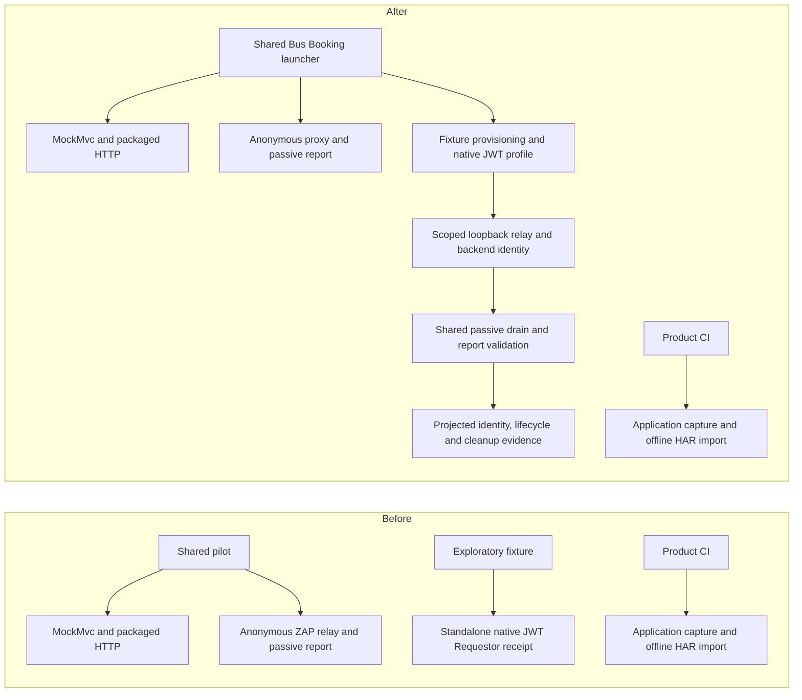

# Security testing framework P0 and P1 completion

24 November 2026, ICT

## Executive summary

The shared framework and Bus Booking integration have local, reproducible source revisions. The measured native scanner run passed, and the final shared revision passed its offline contract checks. Docker became unavailable during final runtime regression, leaving several reruns open. The existing live product launcher now provisions a verified USER and runs native ZAP JSON login and Bearer session management through the shared passive engine. ZAP's named Requestor and poll resolve to the fixture identity on the packaged backend. The product-native CI workflow continues to passively analyze archived HTTP exchanges in its offline HAR lane.

The product full run reports execution **PASS** and release security acceptance **MISSING**. The review records 18 PASS, eight REVIEW, and two MISSING objectives, with dispositions for both informational login findings and all 12 API contract-drift entries. Shared Authenticated Active DAST is **BLOCKED** at admission, and product Active DAST verification is **MISSING**. [Initial audit](CURRENT-STATE-AUDIT.md) · [Product acceptance matrix](/Users/hahoangloc/Working/UET/bus-booking-security-ci/docs/security-acceptance-p0-p1.md)

## Architecture before and after

The new branch of the shared live runner shares the database container's disconnected loopback namespace with the app, Mailpit and ZAP. It publishes zero ports. Provisioning uses ordinary registration and email verification, and the scanner owns the subsequent login. The relay serves ZAP's preliminary login-page GET locally. It forwards the exact login POST and protected profile GET, then correlates the Bearer value against the real login response in memory. A named Requestor and a poll must both match the verified fixture principal and USER role. The archived HAR lane runs ZAP with request sending disabled in a disconnected container. [Shared framework](docs/security-test-framework.md) · [Live runner specification](tests/security/suites/bus_booking/specifications/native-jwt-passive.md) · [Product HAR plan](/Users/hahoangloc/Working/UET/bus-booking-security-ci/tests/security/zap.yaml)

## P0 and P1 completion matrix

| Task | Status | Result |
| --- | --- | --- |
| P0.1 Shared framework stabilization | VERIFIED | Baseline source, specs, CI contract, and sanitized historical evidence committed. The historical pilot comparison and its evidence controls revalidate against the baseline source. |
| P0.1 Bus Booking stabilization | VERIFIED | The PR-era revision and mutation fix are versioned. The full product execution and subsequent clean build agree on the application binary and suite-file digests. The exploratory worktree keeps its unrelated modifications and prototype files. |
| P0.2 Review all 28 requirements, findings and drift | VERIFIED | Each requirement is mapped to its CWE, case or source evidence, disposition and remaining acceptance gate. Fresh product evidence is linked below. |
| P0.2 Database mutation return values | VERIFIED | Product guards now require exactly one affected row for role, email verification and booking status mutations. Four targeted negative tests pass. The criterion still carries its manual write/lock and transactional review. |
| P0.2 Release security acceptance | MISSING | Two browser-dependent criteria lack a runnable product frontend. Eight criterion reviews, 12 API drift entries, the current passive baseline and active qualification remain open. |
| P1.1 Native ZAP JWT session at the measured source snapshot | VERIFIED | The positive lane resolves one USER for one protected GET and compares it with the observed anonymous denial. |
| P1.1 Final revision repeat and live wrong-password control | IMPLEMENTED_NOT_VERIFIED | The final contract rejects contradictory authentication evidence offline. Docker failed before the final positive and wrong-password runs reached ZAP. |
| P1.2 Scanner-owned authenticated passive at the measured source snapshot | VERIFIED | Native plan preflight, job receipts, passive wait, scoped report, detector and cleanup passed. The report separates product login observations and synthetic control instances. |
| P1.2 Externally captured authenticated HAR passive | VERIFIED | The existing product plan and parser reconcile the archived exchanges with ZAP history. Product authentication and role verification remain independently visible. |
| Final shared transport and synthetic reruns | BLOCKED | The post-change MockMvc gate passed. Readiness deadlines, scanner preflight timeouts and subsequent Docker daemon failure interrupted the full post-change set. |
| Local Docker verification environment | FAILED | The host exhausted writable space and the Docker API timed out after task-owned build cleanup restored space. |
| P1.3 Shared Active DAST restriction and receipt | VERIFIED | Schema, admission and CI agree on an explicit no-dispatch receipt and exit 3. Native plan admission is exercised offline. |
| P1.3 Authenticated Active DAST qualification | BLOCKED | Shared runner admission returns BLOCKED. Local product evidence remains MISSING for active dispatch, identity correlation, lifecycle and results. |
| P1.3 Hosted shared and updated product workflow evidence | IMPLEMENTED_NOT_VERIFIED | The shared CI definition includes a blocked-case assertion. Local contract checks cover the shared CI admission assertion and the product full run exercises the existing CI entry point. Hosted evidence covers the earlier product source revision. |

## Changes and source revisions

- **Framework** `e8197caab2d530287214b0e7b8231a3691e0bba8` is the original tracked base. `a5401a16568bc852e53dd7eaaf92e96a0fcf1041` versions the baseline. `0117bc0defc891d3eb4644c53635e7e547daa5ca` adds the native JWT profile, admission, lifecycle and evidence integration, Bus Booking adapter, contract tests and CI declarations. The measured inputs of the successful live receipt were reconstructed byte for byte and committed as `546cce391d08a67b0a88f1fbde34c7fd60352d66` on `codex/security-framework-native-measured`. The final evidence commit on `codex/security-framework-p0-p1` adds this report and the projected verification records. [Native JWT renderer](tests/security/security_framework/native_jwt.py) · [Shared scanner engine](tests/security/security_framework/engine.py) · [Evidence validation](tests/security/security_framework/evidence.py) · [Workflow](.github/workflows/security-suite-framework.yml)
- **Bus Booking** `56f58a3ed86d22d44bd2007e3a49aeb0c979510f` is the committed CI baseline. `9059a1b0942191a8b23ebdc98873dc36213ffd49` checks affected-row contracts and adds four tests to criterion traceability. `cb83d656424a22bec0a75a4a7919117d8609ddce` adds the acceptance matrix and runbook link on `codex/bus-booking-security-p0-p1`. [Product scope](/Users/hahoangloc/Working/UET/bus-booking-security-ci/tests/security/scope.json) · [Mutation row count tests](/Users/hahoangloc/Working/UET/bus-booking-security-ci/src/test/java/com/example/busbooking/data/adapter/MutationRowCountTest.java)
- **Exploratory proof** `cc0ac2451227971367de9c7f9153f908c0c8d315` is the tracked base of the dirty lab worktree. Its original runner and plan match the hashes in the retained receipt. The currently present exploratory JAR digest differs from the proof's JAR digest. The integrated lane rebuilds the actual committed product revision through the existing shared launcher. [Sanitized historical session receipt](tests/security/suites/bus_booking/evidence/p0-p1/historical-native-session.json)
- **Hosted provenance** PR #20's run head was `56f58a3` and its tested merge snapshot was `ff5c9e606697ea87a387f60403ef5408fb5bdcb8`. Artifact `14848308972` had ZIP SHA-256 `f31d959a5ba9eeb55d7a308864710156b4478960a619ec931de758abf910d809`. The initial audit verified it against locally retained results and checked the product suite-file hashes. [Hosted run and artifact](https://github.com/maaL6/bus-booking-system-phase-2/actions/runs/45236299340/artifacts/14848308972)

## Execution results and regression comparison

| Lane | Baseline | P0/P1 result |
| --- | --- | --- |
| Shared offline tests | 43 PASS | 46 PASS, with explicit native JWT plan admission and receipt contradiction controls |
| Shared synthetic suite | 16 expected outcomes in historical qualification | Fresh runs matched six of 16 pre-change outcomes and eight of 16 post-change outcomes. The other fresh attempts did not reproduce their expected outcomes once validation or Docker deadlines intervened. The historical 16/16 qualification and fresh receipts remain separately indexed. |
| Shared Bus Booking MockMvc and paired packaged HTTP | 102 authorization cells across 25 operations, plus 18 application authentication and role conditions | Fresh pre-change MockMvc and packaged HTTP passed. Post-change MockMvc passed with the same normalized response, state and identity results. Two packaged reruns missed application readiness, so the four-run post-change comparison could not pass. |
| Anonymous proxy and passive | Bounded product GET and synthetic CSP detective control PASS | The pre-change anonymous proxy/passive run passed. The post-change attempt timed out before a complete scan. |
| Native JWT Requestor and passive | Standalone lab receipt proves native scanner-owned identity for one USER | At framework snapshot `546cce3` and product `56f58a3`, the native session, passive lifecycle, positive detector and cleanup passed. Final integration revision retries failed during fixture startup. The measured receipt also passes the newer passive and identity checks offline. |
| Product-native full CI | Hosted execution PASS with 316 Maven results, 100/100 HTTP situations across 32/32 operations, 12/12 ownership situations and 133 reconciled HAR exchanges | Local full execution PASS. All 320 Maven tests, 100/100 HTTP situations, 32/32 operations, 12/12 ownership controls and 133/133 HAR exchanges passed. The runner marked this checkout dirty because of generated Python cache files. A clean retry built an identical JAR and suite inputs and passed 320 Maven tests before Docker prevented backend startup. |
| Product separate exhaustive HTTP matrix | Historical 130/130 PASS independently of the shared pilot | PASS, 130/130 and fixture cleanup. Executed from the clean product worktree as an independent suite. |
| Product long mode | Historical exploratory run at dirty source | The fresh long run passed 12 race invariants and the live application-client JWT expiry/fresh-login and quota-recovery checks before the OTP expiry request timed out. The stalled scan was interrupted for cleanup. The long-run execution gate remained MISSING, and the clean retry passed 320 Maven tests before failing backend startup. |
| Product reporting and contract checks | 11 unit tests PASS, 28 criteria / 32 operations / seven exclusions | 11 PASS and matching scope coverage, with all four new database mutation tests passing in Maven |
| Shared Active DAST and generic JWT no-dispatch | Both returned exit 3 | Both product suite controls returned BLOCKED/3 with a single no-dispatch receipt. The synthetic equivalents also matched their expected outcomes. |

The positive passive detector is `10038-1` on the synthetic HTML control. Native report rows on the login operation identify authentication and session-management behavior. The verified profile produces no finding in this run. The completed passive drain follows the authenticated Requestor. The receipt contains the backend-poll and named-request observations, the ordered scanner jobs, report hash and scope, the resolved role and teardown. The final wrong-password runtime control is unmeasured. Offline receipt controls reject a 401 login, invalid role, mismatched token, missing poll, missing detector and incomplete cleanup. The first implementation attempt correctly rejected ZAP's preliminary login-page GET as outside scope. The final relay accounts for that known GET inside the disposable fixture. [ZAP JSON authentication behavior](https://www.zaproxy.org/docs/desktop/ui/dialogs/session/context-auth/) · [Passive drain job](https://www.zaproxy.org/docs/desktop/addons/passive-scanner/job-pscanwait/)

The retained verification index carries receipt references, SHA-256 digests, runtime and suite inputs, and the separate shared and product classifications. Full projected outputs are also available under the local artifacts directory. Credential values, JWTs, HAR traffic, raw scanner reports, startup logs and application JARs were transient. [Versioned evidence and provenance](tests/security/suites/bus_booking/evidence/p0-p1/verification.json) · [Local verification artifacts](artifacts/p0-p1-after)

## Security objective acceptance

The product-native release acceptance remains **MISSING**. The [28-row product matrix](/Users/hahoangloc/Working/UET/bus-booking-security-ci/docs/security-acceptance-p0-p1.md) identifies each executable or static witness and the gap for each open requirement.

- **PASS (18).** SEC-A01-01, SEC-A01-02, SEC-A01-07, SEC-A02-04, SEC-A03-01, SEC-A04-05, SEC-A04-06, SEC-A05-04, SEC-A06-01, SEC-A07-01, SEC-A07-03, SEC-A07-05, SEC-A08-05 and SEC-A10-02 through SEC-A10-06.
- **REVIEW (8).** SEC-A02-05 needs policy decisions for hard-coded security settings. SEC-A05-01 needs a complete endpoint-to-query binding review. SEC-A08-02 needs effective container PATH evidence. SEC-A08-03 needs deployed DTO and JWT key trust evidence. SEC-A09-01 through SEC-A09-03 need wider log sink validation and the four named security events. SEC-A10-01 needs final review of the scoped write/lock and rollback evidence.
- **MISSING (2).** SEC-A06-03 and SEC-A06-05 require the real product frontend revision and reproducible browser startup. The backend reports show cache headers and server-side enforcement for their scoped operations.
- The historical reviewed ARM64 baseline binds runtime OpenAPI digest `fbea8ee16547777a7e190ae2386401404cdda7df50f450216cb2aaf2d9119ffa`. The hosted and clean pre-change source produced `adb60fb6effef029039fa039bae32f902330b8a380516d532cf145f4c40dfb72`. Supplying the older baseline produced `MISSING / baseline_incompatible` at execution. The CI-equivalent run leaves the baseline gate in REVIEW for a new compatible, approved capture. The login findings remain in evidence. Both document expected behavior. [ZAP rule 10111](https://www.zaproxy.org/docs/alerts/10111/) · [ZAP rule 10112](https://www.zaproxy.org/docs/alerts/10112/)
- All 12 contract drift items remain REVIEW. Their runtime observations are recorded and the API design and OpenAPI correction required for each operation is documented. [Contract drift dispositions](/Users/hahoangloc/Working/UET/bus-booking-security-ci/docs/security-acceptance-p0-p1.md)

## ZAP capability status and blockers

| Capability | Status | Scope and remaining evidence |
| --- | --- | --- |
| Anonymous Requestor, proxy and passive scan | VERIFIED | Disposable loopback relay, public locations and a synthetic detector control. |
| Native form and cookie passive | VERIFIED | Synthetic form fixture with bounded Requestor and independent actor witness. |
| Offline HAR passive processing | VERIFIED | Product-native authenticated application-client capture, neither backend access nor request sending by the scanner. |
| Native JWT Requestor, poll and passive scan | VERIFIED | One verified USER, one protected profile read, expected login findings, synthetic detector, fresh scoped report, cleanup. |
| JWT expiry and renewal owned by ZAP | MISSING | The measured scanner profile and poll use one freshly issued token. Time-bound expiry and scanner-managed re-login with a second backend-correlated token require separate evidence. Product-native application-client JWT temporal checks are separate. |
| Additional scanner roles, frontend and product discovery | MISSING | Current scanner profile covers one USER and fixed operation. Product frontend revision and discovery evidence are unavailable. |
| Authenticated Active DAST dispatcher | BLOCKED | Shared case method maps to a no-dispatch receipt. The passive engine rejects extra jobs. Product CI uses an offline HAR container and has no active adapter. |
| Bus Booking Active DAST qualification | MISSING | No product active run, active component session observation, scope-aligned request attribution, terminal evidence, report or cleanup for active execution. JWT session behavior outside Requestor and poll, target-input coverage and native active technical limitations remain unmeasured. |

An independent active qualification requires an explicitly authorized mechanism and ownership and isolation for the exact environment. The current result schema and CI checks classify the restriction. The product must separately establish its adapter, scope, execution and evidence contract, effective scanner identity and fixture lifecycle. [Active evidence boundary](ci-verdict-contract.md#authenticated-active-dast)

## Verification environment blocker

The post-change shared packaged HTTP diagnostic timed out waiting for application readiness. Multiple synthetic ZAP preflights hit their 90-second deadline. The host later reported `no space left on device` and the Docker daemon stopped answering its Unix socket and CLI health checks. Removing task-owned build output restored free space. Docker remained unresponsive, so clean product retries could not confirm container teardown. Docker recovery and task-owned cleanup verification are required before final runtime reruns. The index retains failed and incomplete attempts separately from the accepted results.

## Reproduction and dependency record

Use Python 3.13.2, JDK 21.0.13 and Maven Wrapper 3.10.2 to reproduce the local evidence. Docker Engine 29.8.1 ran Linux ARM64 containers. The product POM pins Spring Boot 4.2.0, JJWT 0.13.0 and springdoc 3.2.0. Actual native ZAP and product HAR receipts bind the selected scanner image, and the product report records the bundled add-ons. [Product POM](/Users/hahoangloc/Working/UET/bus-booking-security-ci/pom.xml) · [Shared live commands](tests/security/suites/bus_booking/live/README.md) · [Product runbook](/Users/hahoangloc/Working/UET/bus-booking-security-ci/docs/security-runbook.md)

- ZAP 2.17.0 `zaproxy/zap-stable@sha256:030d3df57735dacbb83464854758e674dd9ad01d79d12a129a8e58b1fd384238`.
- PostgreSQL 16 Alpine `postgres@sha256:1d5b02d3a9941fbd52437db4107f8c52d6297dac553ca1e5c299ebb3756b4857`.
- Temurin 21 JRE `eclipse-temurin@sha256:d77e090ae1f6970c047b443c6f0a6c1358b0426d44432bb5a7753408cd43de0d`.
- Mailpit 1.27.8 `axllent/mailpit@sha256:6abc8e633df15eaf785cfcf38bae48e66f64beecdc03121e249d0f9ec15f0707`.

Run the shared contract tests using `PYTHONPATH=tests/security python3 -m unittest discover -s tests/security -p 'test_*.py'`. Use the recorded revisions in the live launcher for `http`, `passive`, `authenticated-passive` and `authenticated-passive-bad-password`. Use `suites.bus_booking.adapter` for MockMvc and `suites.bus_booking.live.compare` for the four shared pilot receipts. Run the product-native `tests/security/run.py --validate`, reporting tests, `--mode full`, `--mode long`, and the separate `tests/security/authorization_matrix.py` from Bus Booking.

## P2 and P3 handoff

- **P2 candidate scope.** Close the remaining backend and frontend evidence obligations, correct and review API contracts, qualify an approved compatible passive baseline, and add reliable execution paths in product and shared CI for any additional verified lanes.
- **P3 candidate scope.** Version criterion-to-alert attribution and distinguish risk groups, instances, synthetic controls and unmeasured coverage. Extend native scanner role and session lifecycle evidence as needed. Active dispatch and qualification remain dependent on the explicit execution boundary above. [Exploratory roadmap](/Users/hahoangloc/Working/UET/bus-booking-system-phase-2/docs/security-assessment-status-and-roadmap.md)
